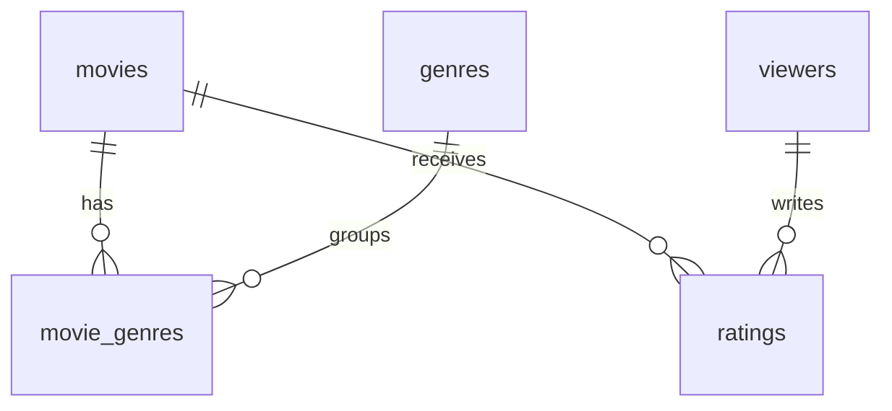

# Movie Ratings Lab

Dự án học **SQLite + Python + pandas + Seaborn + Matplotlib + Jupyter** qua theo dõi phim và đánh giá. Có menu tiếng Việt, notebook, SQL, bài tập và kiểm thử. Mẫu là **GIẢ LẬP**, không dùng thông tin phim/người xem thật.

## Bắt đầu trên Windows

Cần Python 3.12. Mở PowerShell:

```powershell
git clone https://github.com/domixilaphungthodanh/movie-ratings-lab.git
cd movie-ratings-lab
python -m venv .venv
.venv\Scripts\python.exe -m pip install -r requirements.txt
.venv\Scripts\python.exe -m movie_lab.init_db --sample
.venv\Scripts\python.exe -m movie_lab.cli
```

Không cần kích hoạt môi trường; gọi trực tiếp Python trong .venv. macOS/Linux thay `.venv\Scripts\python.exe` bằng `.venv/bin/python`. Các lệnh dưới dùng `python` khi môi trường đã kích hoạt; nếu chưa, dùng đường dẫn .venv như trên.

## Thử quy trình

1. Chọn 2, Enter để xem phim. Phim 30 chưa được đánh giá.
2. Chọn 5: phim 30, người xem 1, điểm 8, nhận xét tùy chọn, Enter để dùng hôm nay.
3. Chọn 2: tìm Phim giả lập 30, kiểm tra điểm 8 và số đánh giá 1.
4. Chọn 6: phim 30, người xem 1, điểm 9. Đây là sửa, không tạo đánh giá thứ hai.
5. Chọn 7 để xem; chọn 0 để thoát.

Thêm phim bằng mục 1: nhập nhiều thể loại ngăn bằng dấu phẩy. Thêm người xem bằng mục 3. Tên người xem có thể trùng; mã viewer_id mới là định danh. Phim có thể cùng tên/năm vì dự án chưa có định danh bên ngoài; kiểm tra danh sách trước khi thêm.

## Quy tắc và dữ liệu

- 30 phim, 5 thể loại, 20 người xem, 200 đánh giá năm 2025; seed 42. Phim 30 chưa có đánh giá để luyện LEFT JOIN và NULL.
- Một phim có nhiều thể loại; một thể loại có nhiều phim. Bảng `movie_genres` liên kết chúng.
- Một người chỉ có một đánh giá hiện tại cho mỗi phim. Thêm trùng bị từ chối; sửa phải dùng chức năng riêng và không lưu lịch sử sửa.
- Điểm là số nguyên 1–10; nhận xét tùy chọn. Không có đánh giá thì điểm trung bình NULL, không gán 0.
- Ngày hợp lệ YYYY-MM-DD, không ở tương lai; mặc định hôm nay UTC+7. Năm phát hành giới hạn 1888–2100, cho phép theo dõi phim sắp ra; chưa kiểm tra đánh giá phải sau ngày phát hành.
- Tên và thể loại không rỗng. Thể loại được trim và casefold để không tách nhóm vì chữ hoa/thường; cùng phim không được gắn trùng thể loại.
- Khóa ngoại bật trên mọi kết nối; đầu vào dùng tham số SQL. Thêm phim và gắn thể loại cùng một transaction. Không có chức năng xóa.
- Tìm kiếm theo tên; % và _ là ký tự thường. SQLite LIKE không chuyển hoa/thường đầy đủ cho Unicode; giữ đúng dấu và chữ hoa/thường tiếng Việt khi tìm.

## Thiết kế database



Xem [từ điển dữ liệu](docs/data_dictionary.md). Không ghi đè database: chạy init lần hai sẽ báo lỗi. Muốn thực hành từ đầu:

```bash
python -m movie_lab.init_db --sample --db database/practice2.db
python -m movie_lab.cli --db database/practice2.db
python -m movie_lab.analyze --db database/practice2.db --output outputs/practice2
```

Không dùng --sample để tạo database rỗng. Mọi lệnh phải dùng cùng --db khi chọn database khác.

## Phân tích và notebook

```bash
python -m movie_lab.analyze --min-ratings 5
python -m jupyter notebook
```

Mở `notebooks/01_movie_analysis.ipynb`, chọn kernel .venv, chạy từ trên xuống. Notebook tạo mẫu nếu chưa có database mặc định; không ghi đè file tồn tại. Sửa biến DB ở ô đầu để chọn database khác.

`outputs/` chứa 4 biểu đồ PNG, 4 bảng CSV và report.md: phân phối điểm, top phim, điểm thể loại và khác biệt điểm người xem. Top phim chỉ xét phim có ít nhất 5 đánh giá; dùng --min-ratings để thay ngưỡng. Đây là xếp hạng minh họa, không xác định chất lượng thực.

**Quan trọng:** một đánh giá của phim nhiều thể loại xuất hiện trong từng nhóm thể loại. Không cộng số đánh giá theo thể loại để lấy tổng. Điểm thể loại là trung bình các đánh giá, không phải trung bình đều giữa các phim. Biểu đồ dùng dữ liệu tổng hợp nên không có khoảng tin cậy.

## Cấu trúc và lộ trình

```text
movie_lab/       Kết nối, service, tạo mẫu, menu và phân tích
sql/             Schema và truy vấn thực hành
notebooks/       Học từng bước
docs/            Từ điển dữ liệu, bài tập, lời giải
tests/           unittest trên database tạm
.github/workflows/verify.yml  Kiểm tra tự động và xuất artifact
requirements.txt Thư viện
.gitignore       Bỏ qua database, môi trường và kết quả sinh ra
```

Tuần 1: hiểu bảng và quan hệ nhiều–nhiều, SELECT/JOIN/GROUP BY. Tuần 2: thêm phim, thêm/sửa đánh giá, validation và transaction. Tuần 3: pandas, Seaborn, notebook và viết nhận xét. Làm [bài tập](docs/exercises.md) trước khi đọc [lời giải](docs/solutions.md).

## Kiểm thử và workflow

```bash
python -m unittest discover -s tests -v
```

GitHub Actions chạy khi push/pull request: cài Python 3.12, chạy tests, tạo mẫu, xuất kết quả và chạy notebook. Mở Actions → lần chạy → tải artifact **movie-analysis**, giữ 14 ngày. Database và kết quả không được commit vào repo.

V1 không có đăng nhập, giao diện web, lấy dữ liệu từ API, hệ gợi ý phim hoặc phân tích cảm xúc. Nếu dùng dữ liệu thật, ghi rõ nguồn và giới hạn trong báo cáo.
